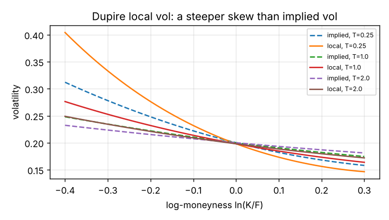
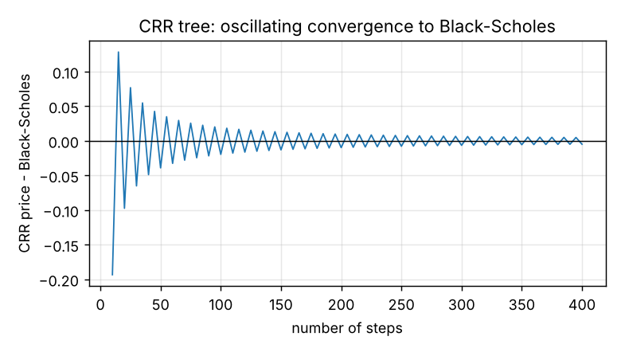
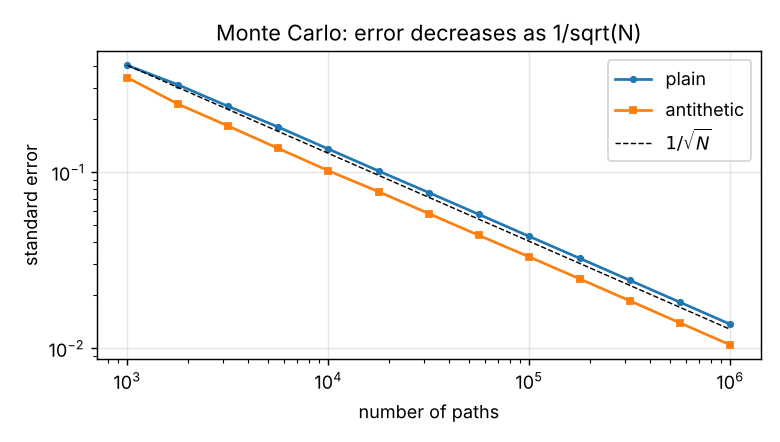
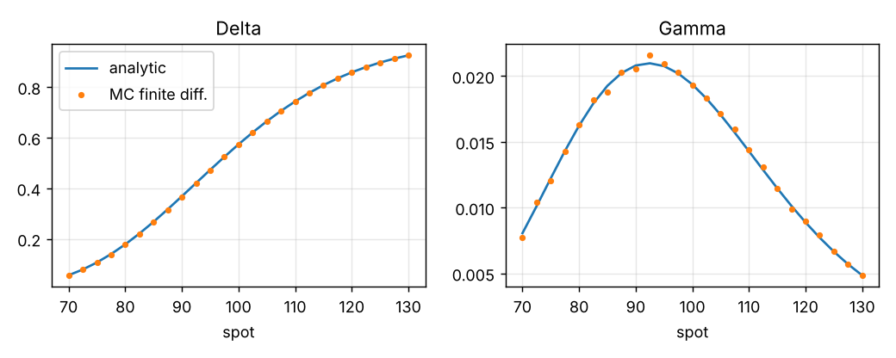

# Equity derivatives lab: pricing and model validation in Python

  

A tested Python toolkit that prices equity options with several independent methods
(closed form, binomial tree, Monte Carlo, local volatility) and **checks them against each other**,
the way a model validation team would. Every number in this README is reproducible with one command.

## At a glance

- **Pricing methods cross-checked:** the binomial tree and Monte Carlo prices both converge to the Black-Scholes price
  (tree error -0.005 at 400 steps, Monte Carlo inside its confidence interval). Monte Carlo Greeks match the analytic
  Greeks (max delta gap 0.002).
- **Correlation repair:** a non-positive-semidefinite correlation matrix is detected and fixed with Higham's
  nearest-correlation algorithm, then used to price a 3-asset basket option.
- **Dupire local volatility:** local vol is built from an implied volatility surface, and the vanillas are repriced by
  Monte Carlo to within about 1.3 standard errors at every strike. Points where the surface allows arbitrage are
  detected and reported, not hidden.
- **Engineering:** 11 `pytest` tests (put-call parity, no-arbitrage bounds, convergence, Greeks), fixed seeds,
  vectorised NumPy, and a single script that regenerates every figure and number.

**Skills shown:** stochastic calculus applied to pricing (GBM, Dupire), numerical methods (trees, Monte Carlo,
variance reduction, finite differences, root finding), numerical linear algebra (eigendecomposition, alternating
projections), and model validation (benchmarking methods against each other, stating limitations).



## What's inside

| Module | What it does |
|---|---|
| `pricing/bs.py` | Black-Scholes prices, analytic Greeks, implied volatility (Brent) |
| `pricing/trees.py` | Cox-Ross-Rubinstein tree, European and American exercise |
| `pricing/monte_carlo.py` | GBM Monte Carlo with confidence intervals, antithetic variates, finite-difference Greeks with common random numbers |
| `pricing/correlation.py` | Admissibility test and **nearest correlation matrix** (Higham 2002, alternating projections with Dykstra's correction) |
| `pricing/basket.py` | Basket option on correlated underlyings |
| `pricing/local_vol.py` | **Dupire local volatility** from an implied volatility surface, Monte Carlo under local vol, explicit detection of arbitrageable regions |
| `tests/test_pricing.py` | 11 tests: parity, bounds, convergence, Greeks, correlation, local vol repricing |
| `examples/report.py` | Regenerates every figure and number below |

## Quick start

```bash
git clone https://github.com/ch-moh/equity-derivatives-lab.git
cd equity-derivatives-lab
pip install -r requirements.txt
pytest -q                     # 11 tests
python -m examples.report     # figures and numbers
```

## Results (`python -m examples.report`)

All numbers below are produced by `examples/report.py` with fixed seeds.
Reference case: S = K = 100, T = 1, r = 3%, q = 1%, σ = 20%.

**Cross-checks between methods**

| Check | Result |
|---|---|
| Black-Scholes call | 8.8273 |
| CRR tree, 400 steps, minus Black-Scholes | -0.0049 (oscillating convergence, see figure) |
| Antithetic variates, standard-error reduction | × 1.31 |
| Delta: analytic vs Monte Carlo finite differences, max gap over spot 70–130 | 0.002 |
| Put-call parity, no-arbitrage bounds, implied-vol round trip | exact to machine precision (tests) |

**Repairing a non-admissible correlation matrix**

A hand-made 3×3 matrix with ρ(1,2) = 0.9, ρ(1,3) = 0.7 and ρ(2,3) = -0.4 looks plausible but is not
positive semi-definite (smallest eigenvalue -0.354), so it cannot be used to simulate correlated assets.
Higham's algorithm returns the closest valid matrix in 22 iterations (Frobenius change 0.438):

```
[[ 1.     0.694  0.526]
 [ 0.694  1.    -0.247]
 [ 0.526 -0.247  1.   ]]
```

The repaired matrix is singular (smallest eigenvalue 0), so the basket simulation factorises it by
eigen-decomposition rather than Cholesky. Equally weighted basket call on 3 assets (σ = 20%, 25%, 30%):
8.641 ± 0.028.

**Dupire local volatility: does the model reprice the vanillas it was built from?**

On a smooth toy equity smile, local volatility is computed from the implied surface, then calls are
re-priced by Monte Carlo under local vol (200,000 paths, 250 steps) and converted back to implied vol.

| Strike | 70 | 80 | 90 | 100 | 110 | 120 | 130 |
|---|---|---|---|---|---|---|---|
| Implied-vol error (bp) | 14.6 | 7.8 | 5.3 | 4.7 | 5.3 | 6.0 | 4.1 |
| Monte Carlo 1 standard error (bp) | 42.4 | 20.0 | 11.0 | 7.1 | 5.3 | 4.6 | 4.6 |

Errors stay within about 1.3 standard errors at every strike: the surface is recovered up to Monte
Carlo noise and time discretisation. The toy surface is arbitrageable far in the wings (negative local
variance); the code refuses such points by default and, in simulation, floors them and **reports how
often** it happened (1.3 × 10⁻⁶ of path-steps here) instead of hiding the repair.

## Figures

| | |
|---|---|
|  |  |
|  |  |

## Limitations and next steps
- The implied surface is a smooth toy smile, not calibrated to market quotes. Next: fit an SVI surface to
  real option prices and check it for butterfly and calendar arbitrage before computing local vol.
- Euler scheme on log-spot; no variance reduction under local vol yet.
- Next: local correlation for multi-asset products, and Greeks under local vol compared with Black-Scholes.

## References
- J. Gatheral, *The Volatility Surface*, Wiley, 2006 (Dupire formula in total implied variance).
- N. J. Higham, "Computing the nearest correlation matrix", *IMA Journal of Numerical Analysis*, 2002.
- J. C. Hull, *Options, Futures, and Other Derivatives*.

## Author

**Mohamed-Walid Chaabane**, engineering student at IMT Atlantique (applied mathematics, market finance),
looking for a quantitative research internship in Paris from March 2027.

[LinkedIn](https://www.linkedin.com/in/mohamed-walid-chaabane/) · [GitHub](https://github.com/ch-moh) · mohamed.chaabane@imt-atlantique.net
